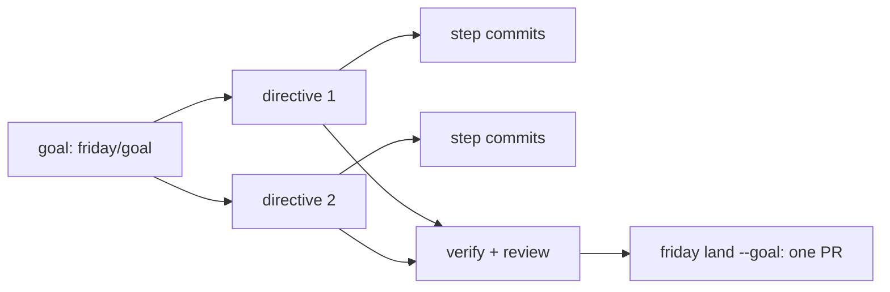

# friday

A Claude Code plugin for research repos: you plan a goal with the model, approve it once, and
friday executes it behind deterministic gates. Each unit of work is a **directive** with a
`Verify:` command; it is done only when that command passes and an independent reviewer agrees.
Hooks enforce what must never bend: a command deny list, running code through `./run`, hardware
behind a prompt and a lease, and commits that name their directive.

v1 replaces the v0.20 multi-role harness (tag `v0.20.0`), which was built for a mid-tier
orchestrator. With Fable or Opus as the session model, friday keeps only the parts that check and
constrain the work.

## Install

```bash
git clone https://github.com/davidmhunt/friday ~/src/friday     # branch v1
claude --plugin-dir ~/src/friday                                 # try it in one session
```

To keep it enabled, add `~/src/friday` as a local marketplace with `/plugin` and install it from
there. Requires Claude Code with workflows (v2.1.154+) and `python3` on the host.

Once per machine, put `friday` on PATH:

```bash
python3 ~/src/friday/bin/friday install      # links ~/.local/bin/friday to this checkout
friday uninstall                             # removes the link again
```

After that, just `friday ...`. On a node: `ssh <node> friday uninstall`. The `uv run` and
`python3 <checkout>/bin/friday` forms still work.

## Use

```text
/friday:plan add range-limit checks for chirp configs     # interview, then directives in docs/directives/
(approve)                                                  # the only planned stop
/friday:execute core-03                                    # implement, verify, review, push, PR
```

Then review the PR (one per goal). `friday status` in a shell (or ask Claude to run it) lists directives, the one
active in this worktree, and hardware leases. See [docs/workflow.md](docs/workflow.md).

Slash commands for the same CLI forms, from any session with the plugin loaded (also over Remote Control):

| Slash command | CLI form |
|---|---|
| `/friday:status` | `friday status` |
| `/friday:nodes [--check]` | `friday nodes` (lists the registry; with `--check` it probes each node over ssh) |
| `/friday:dispatch <goal>` | `friday dispatch --goal <goal>` (shows `--dry-run` first, runs after you say yes) |
| `/friday:clean <node>` | `friday nodes --clean <node>` (shows `--dry-run` first, runs after you say yes) |

## What's in it

| Part | What it does |
|---|---|
| `skills/plan` | Interviews you, writes directives with an executable `Verify:`, asks for approval |
| `workflows/execute.js` | Prepare → implement each step → Verify (fix loop) → Opus review → land |
| `agents/` | `implementer` (Sonnet; Opus for `[heavy]` steps), `verifier` (Opus, read-only), `runner` (Haiku, long and remote runs) |
| `hooks/` | Deny list, `./run` enforcement, hardware prompt + lease, commit trailer, Verify gate on Stop |
| `skills/status`, `nodes`, `dispatch`, `clean` | User-invoked slash commands that run the CLI and summarise it |
| `skills/` | `directive` (format), `hardware`, `long-jobs`, `data-artifacts` |
| `bin/friday` | `status`, `new`, `start`, `verify`, `finish`, `land`, `release`, `check`, `parse`, `nodes`, `dispatch` |

## The goal model

One `/friday:plan` run is a **goal**: one approval, one branch `friday/<goal>`, one PR. A goal lists
**directives**, each with a `Verify:` command and a `Deliverable` (code, doc, slides, external); a
directive is a list of **steps**, each a commit.



| Unit | File | Branch | Check | Lands as |
|---|---|---|---|---|
| Goal | `docs/goals/<goal>.md` | `friday/<goal>` | all its directives verified and done | one PR into its Base (`friday land --goal`) |
| Directive | `docs/directives/<id>.md` | the goal branch (`friday/<id>` for `Land: pr`) | its `Verify:` plus verifier review against `## Acceptance` | commits on the goal branch |
| Step | numbered in the directive | the goal branch | covered by the directive's Verify | one commit |

New commands: `friday check [<id> | --goal <g> | --all]` validates the file formats;
`friday parse <id> --json` (or `--goal <g>`) prints the parsed file; `friday land --goal <g>`
reverifies every directive, marks the goal done and opens the one PR (exit 6: a Verify failed,
nothing pushed). A PostToolUse hook runs the format check on every edited goal or directive file and
sends errors back to the model. Details: [docs/workflow.md](docs/workflow.md).

## Per project

A project adds three things (CPSL_TI_Radar is the worked example):

- `CLAUDE.md`: facts the model can't infer from the code, under about 60 lines.
- `.claude/friday.json`: the run wrapper, which tools must go through it, and hardware patterns.
- `docs/directives/`: one file per directive.

- `.claude/settings.json`: the friday allow rules, merged in by `friday init` (the plan skill runs it
  before the plan commit). They live in the repo because a plugin cannot grant permissions, and
  without them the auto-mode classifier can stop unattended `friday start` or `friday land`.

Optionally a `./run` wrapper and dev container ([docs/runtime.md](docs/runtime.md)) and project
skills under `.claude/skills/`.

## Fleet

A goal whose directives' `Node:` lines this machine doesn't satisfy runs on another machine with
`friday dispatch --goal <goal>` (over Tailscale SSH, in a tmux session on the node). Registry,
node setup and refusals: [docs/fleet.md](docs/fleet.md). `friday dash` on the master serves the
fleet's status over the tailnet only (127.0.0.1 and its tailnet address, port `[dash] port`); see [docs/dashboard.md](docs/dashboard.md).

## Status

v1 is in alpha. Next: a status page ([design spec](docs/workflow.md#roadmap)). Migrating a v0.20 project:
[docs/migrating-from-v0.md](docs/migrating-from-v0.md).

## Tests

```bash
uv run --with pytest pytest tests/ -q
claude plugin validate .
```
