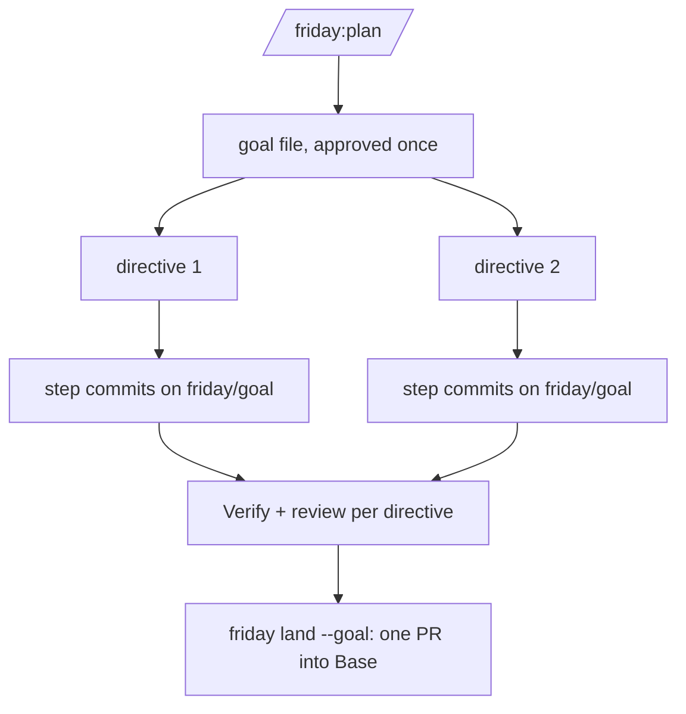

# The friday workflow

You approve once per goal; every directive finishes only when its `Verify:` command passes and an
independent verifier finds no gaps. You review PRs, not steps.

## The model: goal, directive, step

A **goal** (`docs/goals/<goal>.md`) is one user-visible capability (typically 3 to 10 directives), one
branch `friday/<goal>` and one PR into its Base. It may span several planning runs: while its PR is
open, related work extends it as directives added by Base amendments (`friday status` shows each
goal's PR state, and `/friday:plan` looks for an open goal first). It orders **directives** (`docs/directives/<id>.md`); each has a
`Verify:` command, a `Deliverable` (code, doc, slides, external) and numbered **steps**. Every step
that changes tracked files is one commit, and each directive adds one record commit.

The full rules are in [spec.md](spec.md); this page is the walkthrough.

## Walkthrough

1. **Plan.** `/friday:plan <goal>` in a session on Fable or Opus. It reads the repo, interviews
   you, runs `friday init`, and commits the goal file and its directives (`Status: proposed`) on the
   goal branch `friday/<goal>` (created from Base; never on Base) and pushes it.
2. **Approve.** Read each directive's goal, steps, Verify, `## Allowed commands` and out-of-scope
   list; approve, amend or drop. Approved files are committed with `Status: approved`, once for the
   whole goal. If any directive has `## Allowed commands`, you run `friday approve --goal <g>` to publish
   the plan for pre-approval.
3. **Execute.** `/friday:execute <id>` for the first directive; it runs a workflow in the background
   (watch it with `/workflows`):
   - **Prepare**: `friday start <id> --no-gate` switches to the goal branch `friday/<goal>` (created
     from Base on the first directive), merges Base in, and commits nothing.
   - **Implement**: one `implementer` per step, in order; `[heavy]` steps run on Opus.
   - **Verify**: the `runner` runs the Verify command; on failure an implementer fixes the root
     cause and it runs again, up to 4 rounds or until the same failure repeats twice.
   - **Review**: the `verifier` (Opus, read-only, fresh context) checks the directive's commits
     (`friday commits <id>`) against the directive; real gaps get one fix round, then Verify and
     review again.
   - **Land**: `friday finish <id>` writes the record, then `friday land <id>` pushes the goal
     branch (`Land: goal`; no PR yet). With `Land: pr` it pushes `friday/<id>` and opens that
     directive's own PR; with `Land: none` it pushes nothing.
4. **Next directive.** Run `/friday:execute <next-id>`. Directives of a goal run in order on the
   same branch.
5. **The goal's PR.** `friday land --goal <g>` reruns every directive's Verify on the goal branch,
   marks the goal done, pushes `friday/<g>` and opens or updates the one PR into Base.
   - It opens by itself at the end of the last directive when that directive is `Land: goal` and
     `Accept: auto` and Verify and review passed, and every earlier directive is done (an earlier
     one still `awaiting review` makes it exit 7). A dispatched session does this too.
   - **You run `friday land --goal <g>`** when a directive was `awaiting review` and you ran
     `friday accept`; when the last directive is `Land: pr` or `none`; when you ran directives by
     hand; or when a landing step stopped (exit 3 push failed, 4 Base not on origin, 5 no PR because
     `gh` is missing or signed out and a compare URL is printed, 6 a Verify failed, 7 a directive is
     not done). The output says which.
6. **Review the PR** and merge it yourself.

`Accept: user` directives stop at `awaiting review`: the goal branch is pushed, later directives
continue, and you open the `## Review` bullets and run `friday accept <id>` (or
`friday accept <id> --reject REASON`). Agents cannot run it. Likewise only you run
`friday approve --goal <g>`, which publishes the plan's `## Allowed commands` for pre-approval.

The workflow runs one agent at a time. Claude Code also caps any workflow at min(16, CPUs - 2)
agents at once. Allow the `friday` commands in the project's `.claude/settings.json` (`friday init`
does) so the workflow doesn't wait on a prompt for its own bookkeeping.



| Unit | File | Branch | Check | Lands as |
|---|---|---|---|---|
| Goal | `docs/goals/<goal>.md` | `friday/<goal>` | every directive done and reverified | one PR into Base, opened by `friday land --goal <g>` |
| Directive | `docs/directives/<id>.md` | goal branch; `friday/<id>` if `Land: pr` | `Verify:` passes, verifier agrees with `## Acceptance` | commits on the goal branch (`Land: goal`), its own PR (`pr`), nothing (`none`) |
| Step | `## Steps` item | goal branch | covered by the directive's Verify | one commit |

Format checks: `friday check [<id> | --goal <g> | --all]` exits 1 on any error, and a PostToolUse
hook sends a goal or directive file's own format errors back to the model after every edit.

## Pre-approving commands for an unattended or dispatched run

Some commands always prompt: `friday dispatch`, `friday nodes --clean`, `friday release`, and any
command matching a `hardware` pattern. With nobody at the prompt (a dispatched session, or a run you
walk away from) the session waits. List the ones the directive needs in its `## Allowed commands`
section, one command per bullet in backticks, `*` matching any text:

```markdown
## Allowed commands
- `friday nodes --clean alfred`
- `ssh rover ./run ros2 topic list`
- `./run tools/bench.sh *`
```

- The list is read only from `origin/friday-plan/<goal>`, the ref the user's `friday approve`
  publishes from the plan on the goal branch. To add or change it after approval, amend the plan as
  a commit on `friday/<goal>` (never on Base), run `friday check`, and ask the user to run
  `friday approve` again; the session picks it up at its next `friday start` (before the next
  directive, or after a block and `friday unblock`).
- It applies only to the active directive, only to a single simple command (no `&`, `;`, `|`,
  backticks, `$(`), and only answers the prompt.
- Still denied or prompted: the deny list (so privilege escalation, force-push and push to main stay
  refused even if listed, and root commands on a robot over `ssh` stay a step you do),
  `friday accept`, `run_only`, the push and commit guards. A pre-approved hardware command still
  takes the lease and is still refused while another session holds it.

Details: [spec.md](spec.md) section 5. For dispatch see [fleet.md](fleet.md).

## Amending an approved plan

Amendments to an approved goal are commits on its goal branch `friday/<goal>`, checked with
`friday check` and pushed; run `friday approve --goal <g>` again when `## Allowed commands` changed.
`friday start` still merges Base into the goal branch before each directive, and finds a directive that
exists only on Base (`found <id> on <ref>: merging ...`). A conflict confined to `Status:` lines is
resolved in favour of the goal branch; any other conflict aborts the merge and start exits non-zero. A
`done` goal that gains an undone directive is set back to `running`. An amendment to the running directive takes effect when it restarts. While a directive is active, a `commit-msg`
git hook (installed by `friday init` and `friday start`, removed by `friday uninstall`) refuses commits
without `Directive: <id>`; `git commit --no-verify` overrides it deliberately.

## Commit rules

A directive adds as few commits to its goal branch as the work needs:

- `friday start` commits nothing; it prints `base <sha>`. The directive file keeps `Status: approved`
  while it runs.
- A step commits only when it changed tracked files (code, docs, data, configs), with the last
  line `Directive: <id>`. A step that only reproduces, measures or inspects appends its findings
  to the untracked `runs/<id>/notes.md` and commits nothing. Add `runs/` to `.gitignore`.
- `friday finish <id>` writes the record in one commit (`<id>: record results` or `<id>: blocked`):
  Status, the Log entry (commits, the notes, the Verify line, the independent review). The
  workflow passes Verify and review results to that single call.
- So a directive with one code change has two commits: the change and the record.

### Recommended: squash-merge by default

Make squash-merge each repo's default merge method on GitHub, so the base gets one commit per
goal while the goal branch keeps the detail:

```
gh repo edit --enable-squash-merge --enable-merge-commit=false --enable-rebase-merge=false
```

or Settings -> General -> Pull Requests. friday does not change repo settings; you run this.

## When it stops for you

- A hardware command (prompt from the hardware hook).
- A step needs a decision the directive doesn't settle.
- Verify keeps failing, or review gaps remain after a fix round.

In each case the directive gets `Status: blocked: <reason>` and a Log entry. Fix or answer, then
run `friday unblock <id>` (Status back to `approved` with a Log line, one commit; a blocked goal goes
back to `running`) and `/friday:execute <id>` again; work already committed on the branch stays. Do
not edit Status by hand. For a dispatched goal use
`friday dispatch --goal <g> --resume --unblock <id>`.

## Without the workflow

For hands-on work (a bench session), run a directive in the session itself:
`friday start <id>`, work, `friday finish <id>`. While a directive is active in a worktree, the Stop
hook runs its Verify command whenever Claude tries to end a turn and sends it back to work if it
fails (up to 3 times, then it stops for you). `friday start <id> --no-gate` turns that off.

## Hooks

Every rule, with its event, is in [spec.md](spec.md) section 9. In short:

| Hook | Event | Effect |
|---|---|---|
| Deny list | PreToolUse, Bash | Refuses privilege escalation (also after `ssh`), unscoped `rm -rf`, force-push, push to main, `git remote add`, `git clean -f`, `curl \| sh`, raw disk writes |
| `friday accept` guard | PreToolUse, Bash | Refuses `friday accept` from an agent, in any wrapper |
| `./run` | PreToolUse, Bash | With `.claude/friday.json`, refuses bare `python`, `uv`, `cmake`, ... and names the `./run` form |
| Push guard | PreToolUse, Bash | While a directive is active, only an explicit push of the goal's own branch |
| Commit guard | PreToolUse, Bash | While a directive is active: no commit on main or Base; commits need a `Directive: <id>` line (also enforced by the git `commit-msg` hook) |
| Pre-approval | PreToolUse, Bash | Allows a command listed in the active directive's `## Allowed commands` |
| Hardware | PreToolUse, Bash | Commands matching `hardware` patterns ask you and take a lease; another session's lease refuses |
| Format | PostToolUse, Write/Edit/MultiEdit | Sends a goal or directive file's format errors back to the model |
| Verify gate | Stop | Described above |
| Leases | SessionEnd | Releases the session's hardware leases |

A hook bug fails open and prints an error rather than blocking a session.
