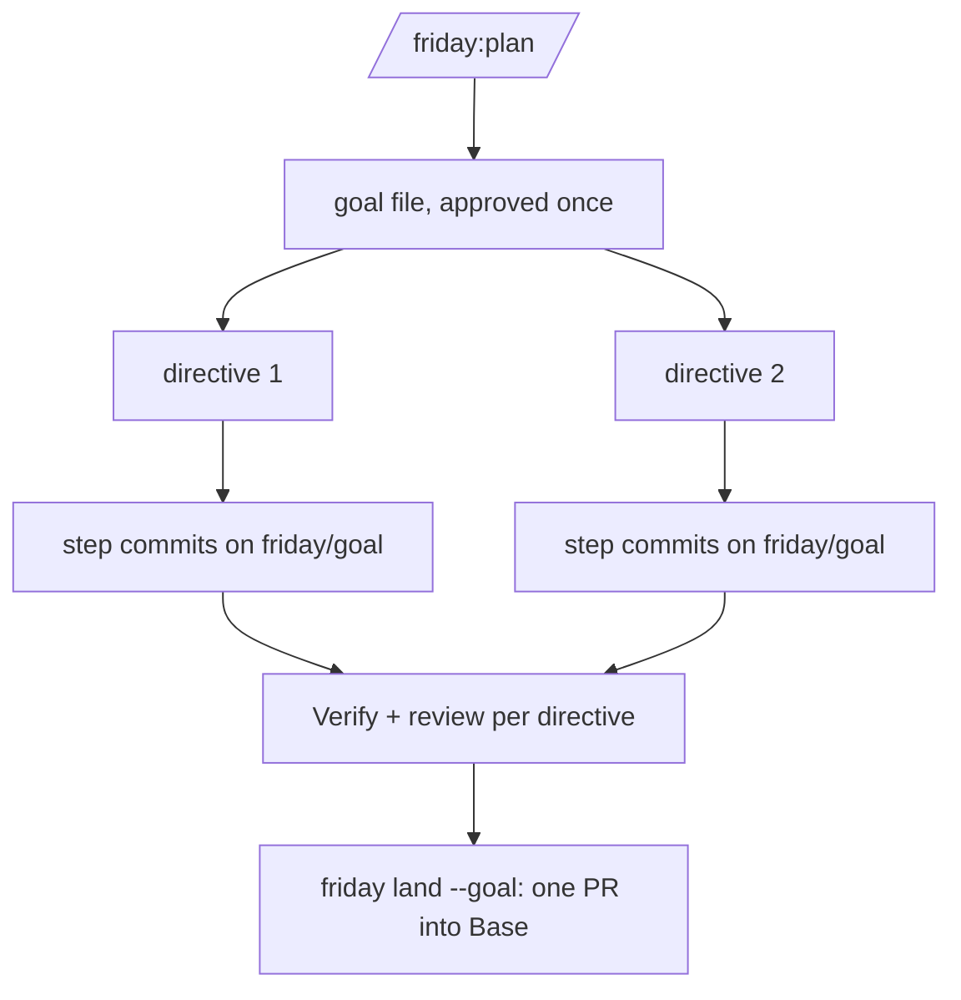

# The friday workflow

You approve once per goal; every directive finishes only when its `Verify:` command passes and an
independent verifier finds no gaps. You review PRs, not steps.

## The model: goal, directive, step

A **goal** (`docs/goals/<goal>.md`) is one planning run, one approval, one branch `friday/<goal>`
and one PR into its Base. It orders **directives** (`docs/directives/<id>.md`); each has a
`Verify:` command, a `Deliverable` (code, doc, slides, external) and numbered **steps**. Every step
that changes tracked files is one commit, and each directive adds one record commit.



| Unit | File | Branch | Check | Lands as |
|---|---|---|---|---|
| Goal | `docs/goals/<goal>.md` | `friday/<goal>` | every directive done and reverified | one PR into Base, opened by `friday land --goal <g>` |
| Directive | `docs/directives/<id>.md` | goal branch; `friday/<id>` if `Land: pr` | `Verify:` passes, verifier agrees with `## Acceptance` | commits on the goal branch (`Land: goal`), its own PR (`pr`), nothing (`none`) |
| Step | `## Steps` item | goal branch | covered by the directive's Verify | one commit |

`friday land --goal <g>` is the step that opens the one PR: it reruns each directive's Verify on
the goal branch, marks the goal done, pushes `friday/<g>` and opens or updates the PR.

### Commands and the format hook

- `friday check [<id> | --goal <g> | --all]`: validate formats; exit 1 on any error.
- `friday parse <id> --json` / `--goal <g> --json`: parsed file as JSON (1 on errors, 2 if missing).
- `friday land --goal <g>`: as above. Exit codes: 0 done, 3 push failed, 4 pushed but base not on
  origin, 5 pushed but no PR (`gh` missing; prints a compare URL), 6 a directive's Verify failed on
  the goal branch and nothing was pushed.
- PostToolUse hook (Write, Edit, MultiEdit): after a goal or directive file is edited, its own
  format errors go back to the model (exit 2); warnings and clean files are silent.

Follow-up (not built): parallel directives within a goal, each on a sub-branch merged into the goal
branch.

The steps below describe a single directive's run.

1. **Plan.** `/friday:plan <goal>` in a session on Fable or Opus. It reads the repo, interviews
   you, and writes directives to `docs/directives/<loop>-<NN>.md` with `Status: proposed`.
2. **Approve.** Read each directive's goal, steps, Verify and out-of-scope list; approve, amend or
   drop. Approved directives are committed with `Status: approved`.
3. **Execute.** `/friday:execute <id>` runs a workflow in the background (watch it with
   `/workflows`):
   - **Prepare**: switch to branch `friday/<id>`, `friday start <id>`.
   - **Implement**: one `implementer` per step, in order; `[heavy]` steps run on Opus.
   - **Verify**: the `runner` runs the Verify command; on failure an implementer fixes the root
     cause and it runs again, up to 4 rounds or until the same failure repeats twice.
   - **Review**: the `verifier` (Opus, read-only, fresh context) checks the diff against the
     directive; real gaps get one fix round, then Verify and review again.
   - **Land**: Log entry, `friday finish <id>`, then `friday land <id> --base <base>`, which pushes
     `friday/<id>` and opens the PR with `gh`. It says plainly when it can't: the push failed, the
     base branch isn't on origin yet (publish it, then rerun `friday land`), or `gh` is missing or
     signed out (it prints the compare URL instead).

   The workflow runs one agent at a time, so it never has more than one agent working. Claude Code
   also caps any workflow at min(16, CPUs - 2) agents at once. Allow the `friday` commands in the
   project's `.claude/settings.json` so the workflow doesn't wait on a prompt for its own bookkeeping.
4. **Review the PR** and merge it yourself.

## Migrating a directive to a goal

A directive written before the goal model (for example `bench-01` in CPSL_TI_Radar) fails
`friday check` with two errors: missing `Goal:` and missing `Deliverable:`. Everything else in it
(Status, Node, Verify, Hardware, Goal/Steps/Out of scope/Log sections) already passes. A
one-directive goal needs:

1. Two header lines in `docs/directives/bench-01.md`, after `Status:`:

   ```
   Goal: bench-warnings
   Deliverable: code
   ```

2. A goal file `docs/goals/bench-warnings.md`:

   ```
   # bench-warnings: Silence the bench_pipeline allocator warning
   Status: approved
   Base: main
   Land: pr

   ## Goal
   A Release build of `bench_pipeline` emits no `-Wmismatched-new-delete` warning, with one PR.

   ## Directives
   1. bench-01: Silence the -Wmismatched-new-delete warning in bench_pipeline

   ## Log
   ```

Then `friday check --all` passes, `/friday:execute bench-01` works on branch `friday/bench-warnings`
and `friday land --goal bench-warnings` opens the PR. `Land:` is optional in the directive (it
defaults to `goal`).

## Amending an approved plan

Amendments to an approved goal are commits on its Base, checked with `friday check`. They reach the
goal branch at the next `friday start`, which merges Base into `friday/<goal>` (or `friday/<id>` for
`Land: pr`) before the directive; a conflict aborts the merge and start exits non-zero. An amendment
to the running directive takes effect when it restarts. While a directive is active, a `commit-msg`
git hook (installed by `friday init` and `friday start`, removed by `friday uninstall`) refuses commits
without `Directive: <id>`; `git commit --no-verify` overrides it deliberately.

## Commit rules

A directive adds as few commits to its goal branch as the work needs:

- `friday start` commits nothing; it prints `base <sha>`. The directive file keeps `Status: approved`
  while it runs.
- A step commits only when it changed tracked files (code, docs, data, configs), with the last
  line `Directive: <id>`. A step that only reproduces, measures or inspects appends its findings
  to the untracked `runs/<id>/notes.md` and commits nothing. Add `runs/` to `.gitignore`.
- `friday finish <id>` writes the record in one commit (`<id>: record results` or `<id>: blocked`):
  Status, the Log entry (commits, the notes, the Verify line, the independent review). The
  workflow passes Verify and review results to that single call.
- So a directive with one code change has two commits: the change and the record.

### Recommended: squash-merge by default

Make squash-merge each repo's default merge method on GitHub, so the base gets one commit per
goal while the goal branch keeps the detail:

```
gh repo edit --enable-squash-merge --enable-merge-commit=false --enable-rebase-merge=false
```

or Settings -> General -> Pull Requests. friday does not change repo settings; you run this.

## When it stops for you

- A hardware command (prompt from the hardware hook).
- A step needs a decision the directive doesn't settle.
- Verify keeps failing, or review gaps remain after a fix round.

In each case the directive gets `Status: blocked: <reason>` and a Log entry. Fix or answer, set it
back to `approved`, and run `/friday:execute <id>` again; work already committed on the branch stays.

## Without the workflow

For hands-on work (a bench session), run a directive in the session itself:
`friday start <id>`, work, `friday finish <id>`. While a directive is active in a worktree, the Stop
hook runs its Verify command whenever Claude tries to end a turn and sends it back to work if it
fails (up to 3 times, then it stops for you). `friday start <id> --no-gate` turns that off.

## Hooks

| Hook | Event | Effect |
|---|---|---|
| Deny list | PreToolUse, Bash | Refuses sudo, unscoped `rm -rf`, force-push, push to main, `git remote add`, `curl \| sh`, raw disk writes |
| `./run` | PreToolUse, Bash | With `.claude/friday.json`, refuses bare `python`, `uv`, `cmake`, ... and names the `./run` form |
| Commits | PreToolUse, Bash | While a directive is active: commits need a `Directive: <id>` line and never land on main |
| Hardware | PreToolUse, Bash | Commands matching `hardware` patterns ask you and take a lease; another session's lease refuses |
| Verify gate | Stop | Described above |
| Leases | SessionEnd | Releases the session's hardware leases |

The rules are carried over from v0.20's guards and incident-driven rules (tag `v0.20.0`). A hook bug
fails open and prints an error rather than blocking a session.

## Roadmap

- **Fleet**: `friday dispatch <id>` starts `/friday:execute` in a fresh Remote Control session on
  the machine that fits the directive's `Node:` line, over Tailscale SSH; sessions report back
  with cross-session messages. Robots stay SSH targets.
- **Status page**: the dash, collected from every node and served on the tailnet (`friday dash`).
